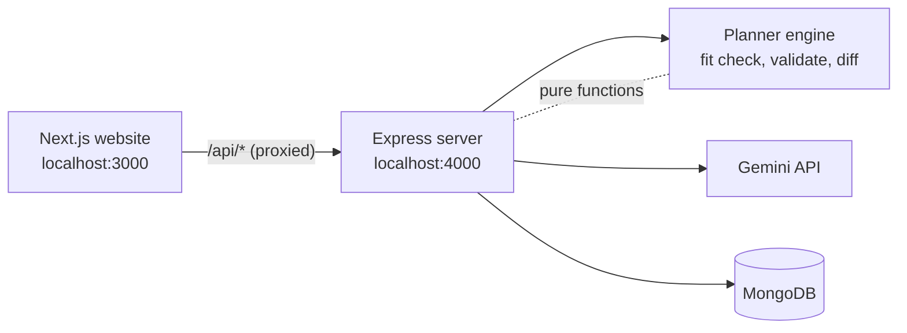

# StudyFlow — Technical Spec

Implements `prd.md` (approved) and keeps to `scope.md > The POC Boundary`.

## How This Works, In Plain Language

StudyFlow is two programs that run side by side on your computer, plus a database.

- **The website (Next.js).** This is what the student sees on a phone or desktop: the login page, the study-hours and courses forms, the day-by-day plan, the check-in buttons, and the replan screen. It holds no important data. It shows what the server tells it and sends back what the student does.
- **The server (Express on Node).** This is the "brain behind the curtain." It handles accounts, saves everything, does the arithmetic (do the hours fit?), asks Gemini to write the timetable, and checks Gemini's answer before anyone sees it. Your Gemini key lives only here.
- **The database (MongoDB, through Mongoose).** A spreadsheet-like store the server reads and writes. It keeps the account, the study hours, the courses and topics, and the plan. Close the browser, come back tomorrow, and everything is still there.
- **Gemini.** The AI planner. The server sends it the student's topics, deadlines and available hours, and it sends back a timetable as structured data (not prose). For a replan it also sends back a short reason for each thing that moved.

**Why this shape.** You asked for Next.js, Express and MongoDB, and each has a clear job. Two decisions keep it small:

1. **The AI plans, and the server checks its work.** Gemini builds the timetable, but the server verifies that no day exceeds the student's hours, every topic lands before its own exam, and all required hours are covered. A bad answer never reaches the student.
2. **The server does the arithmetic, not the AI.** "Do the hours fit before the exams?" is plain addition, so the server answers it instantly and exactly. Gemini is only called once a plan can actually be built.

You could read this aloud as: *"The student types in their courses; my server adds up whether it fits, asks Gemini to lay out the days, double-checks the answer, and saves it. When they fall behind, the server works out what's left and asks Gemini to reshuffle, then shows what moved and why and lets them accept or reject it."*

## The Core Journey Through the System

PRD ref: `prd.md > The Core Journey`. Pages are in `client/app/`, server code in `server/src/`.

1. **Arrive** → the browser opens `http://localhost:3000`. The root page asks the server `GET /api/auth/me`. No session cookie means redirect to `/login`. (`prd.md > Screens and Layout`: Login page)
2. **Register / sign in** → the form posts to `/api/auth/register` or `/api/auth/login`. The server hashes or checks the password, and sets a login cookie that browser JavaScript cannot read. On a first-ever login the student goes to `/welcome`, and "Continue" marks `hasSeenWelcome = true`. (Welcome message)
3. **Set study hours** → `/setup/hours` saves weekday hours X, weekend hours Y and optional per-weekday overrides with `PUT /api/setup`. (Setup: study hours)
4. **Add courses** → `/setup/courses` saves each course (name, exam date, topics with difficulty and hours) with `POST /api/courses`. (Setup: courses)
5. **Generate plan** → the student clicks **Generate plan** and the browser sends `POST /api/plan/generate { today }`. The server then:
   1. loads the setup and courses,
   2. runs the **fit check** (plain arithmetic, no AI),
   3. if the hours don't fit, replies `needs_fit_choice` with the "add x hours daily / add y hours on one or two days" options (and the "keep my hours" lighter-plan path). The browser shows the **Can't fit** panel and re-sends the request with the student's `fitChoice`,
   4. otherwise (or once a choice is made) asks Gemini for the timetable,
   5. **validates** the answer, retrying once if it's wrong,
   6. saves it as the student's plan and returns it. (Plan generation, When the plan doesn't fit)
6. **Check the plan** → `/plan` shows a list of days up to the last exam. Each day is a collapsed row that expands to its hour blocks. (Plan view)
7. **End-of-day check-in** → the student marks each block completed / partial (hours studied, optional "still need more time") / untouched. This is saved with `PUT /api/plan/checkin`. The screen shows "x hours left" for partial blocks straight away. (Daily check-in)
8. **Replan or move forward** → if anything was partial or untouched:
   - **Replan** → `POST /api/plan/replan { today }`. The server works out the remaining work per topic, runs the same fit check, asks Gemini to reshuffle the days after today, validates, compares the new schedule to the old one to find what actually moved, and saves it as a **pending proposal**. The browser shows the moves with Gemini's reasons. **Accept** (`POST /api/plan/replan/accept`) swaps the proposal in. **Reject** (`POST /api/plan/replan/reject`) throws it away. (Replan)
   - **Move forward** → `POST /api/plan/move-forward { date }` marks that day resolved with no change to the schedule. Unfinished blocks show a **remaining** alert. (Moving forward without replanning)
9. **Come back** → on the next login, `GET /api/plan` returns the saved plan. The page expands today's row and collapses the rest. Nothing is kept only in the browser. (`prd.md > States and Boundaries`: Returning)

**Editing later.** On `/setup/...` the student can change hours, courses, topics, difficulty or exam dates at any time. After a save, if a plan exists, the browser calls `POST /api/plan/replan { today, reason: "edit" }`, which produces a proposal to accept or reject (see **Decisions and Open Issues**). (`prd.md > Editing after the plan exists`)



## Stack

| Piece | Choice | Why / tradeoff | Docs |
|---|---|---|---|
| Frontend | **Next.js** (App Router), React, plain JavaScript | Your choice. JavaScript rather than TypeScript keeps setup light (see Open Issues). | [Next.js docs](https://nextjs.org/docs) |
| Backend | **Node.js + Express** | Your choice. Separate API process. | [Express](https://expressjs.com/) |
| Database | **MongoDB** via **Mongoose** | Your choice. You already have a connection string. | [Mongoose](https://mongoosejs.com/docs/), [MongoDB Atlas](https://www.mongodb.com/docs/atlas/) |
| AI | **Gemini API** via `@google/genai`, default model `gemini-3.5-flash-lite` | Your key. Model is set in one env variable so it can be swapped (for example to `gemini-3.6-flash`, which was overloaded with 503s when tested). | [Models](https://ai.google.dev/gemini-api/docs/models), [Structured output](https://ai.google.dev/gemini-api/docs/structured-output), [`@google/genai`](https://www.npmjs.com/package/@google/genai) |
| Passwords | **bcryptjs** (hashing) | Passwords are never stored as typed. | [npm](https://www.npmjs.com/package/bcryptjs) |
| Login session | **jsonwebtoken** in an **httpOnly cookie**, set by Express | You accepted this over localStorage. Next.js forwards `/api/*` to Express so the cookie is same-origin. | [npm](https://www.npmjs.com/package/jsonwebtoken), [Next rewrites](https://nextjs.org/docs/app/api-reference/config/next-config-js/rewrites) |
| Input shape checks | **zod** | Checks request bodies and Gemini's JSON shape. | [zod](https://zod.dev/) |
| Dev convenience | **concurrently** | One `npm run dev` starts both programs. | [npm](https://www.npmjs.com/package/concurrently) |
| Server tests | Node's built-in `node:test` | Light tests for the planner's pure functions. No extra framework. | [node:test](https://nodejs.org/api/test.html) |
| Fonts | `next/font/google`: Fredoka (headings), Nunito (body) | Playful but readable (see Look and Feel). | [next/font](https://nextjs.org/docs/app/api-reference/components/font) |

**Not verified (check at the start of the build, and say so in the checklist):**
- Exact package versions. Use current stable releases and record them in each `package.json`.
- The `@google/genai` structured-output option for Node. A search suggested `responseMimeType: "application/json"` plus `responseJsonSchema`, but I did not find an official Node example. First build step: one tiny test call proving your key, the model name and a JSON reply all work.
- Whether `gemini-3.5-flash-lite` is enabled for your key, plus its free-tier rate limits and cost.
- Node version. Assume Node 20 or newer (`node -v`).

## Where It Runs and How Someone Tries It

**Runtime:** everything runs locally. Next.js on port 3000, Express on port 4000, and MongoDB at your existing connection string. Next.js proxies `/api/*` to Express. Deployment is optional and not planned. The required demo video can be recorded locally, and the public GitHub repo must contain no secrets.

**Environment** (`server/.env`, git-ignored; copy from `server/.env.example`):

| Variable | Meaning |
|---|---|
| `MONGODB_URI` | Your MongoDB connection string |
| `GEMINI_API_KEY` | Your Gemini key (server only) |
| `GEMINI_MODEL` | Defaults to `gemini-3.5-flash-lite` |
| `JWT_SECRET` | Any long random string |
| `PORT` | `4000` |

**Start it:**

```
npm run install:all     # installs root, client and server dependencies
cp server/.env.example server/.env   # then fill in the values
npm run dev             # starts the server (4000) and website (3000)
```

Open `http://localhost:3000`.

**Demo recording script** (for `6-ship`): register → see the Welcome message → set weekday and weekend hours → add two courses with three topics each, at least one exam within about two weeks → Generate plan (include a squeezed case to show the Can't fit panel) → expand a day → check in with one partial and one untouched block → Replan → show what moved and why → Accept → watch the timetable reshuffle. All data is typed live; there is no hidden seed data.

## Look and Feel

Carried from `prd.md > Look and Feel`: playful but soothing, restrained color, playful type, a consoling and confident voice. The style is plain CSS (`globals.css` with CSS variables, plus CSS Modules where useful), so the stack never limits it.

- **Palette (a starting point, adjustable):** warm off-white background `#f6f4ee`, white cards, deep slate-green text `#2b3a3a`, one sage accent `#5b9a8b`, one soft warm highlight `#e9a96b` used sparingly for "what moved" and gentle alerts. No red anywhere, because stressed students should not see alarm colors. The same tokens are used in the PRD page.
- **Type:** Fredoka for headings and buttons, Nunito for body text.
- **Density:** spacious and calm. Large tap targets (at least 44px) because it must work on a phone. Single column on mobile; on desktop the app uses the full screen width (multi-column layouts), as the PRD requires.
- **Copy tone:** reassuring and never guilt-inducing. Examples: "No worries, let's find a new rhythm." and "You may not cover everything, and that's okay. Start with these, they matter most."
- **Motion:** gentle. Day rows expand with a short ease. Moved blocks in a replan proposal get a soft highlight.
- **Responsive:** one layout that stretches from phone to desktop. On wide screens the layout uses multiple columns to fill the screen.
- Light theme only. Dark mode is not needed for the POC.

## Components

### Website (client/)

#### App shell and routing
`client/app/layout.js` loads fonts, global styles and the auth provider. `client/app/page.js` decides where the student belongs: no session → `/login`, not yet welcomed → `/welcome`, no setup → `/setup/hours`, no plan → `/setup/courses`, otherwise `/plan`. The shared helper `lib/api.js` wraps `fetch` and handles a 401 by redirecting to `/login`.
PRD ref: `prd.md > Screens and Layout`, `prd.md > States and Boundaries`.

#### Login page
`/login`. One form with Register / Sign in tabs. Wrong password or a taken username shows a short friendly message from the server.
PRD ref: `prd.md > Account`, `prd.md > States and Boundaries` (Login problems).

#### Welcome message
`/welcome`. Explains what StudyFlow does in a few kind sentences; "Let's start" saves `hasSeenWelcome` and goes to `/setup/hours`.
PRD ref: `prd.md > The Core Journey` step 2.

#### Setup: study hours
`/setup/hours` (`HoursForm`). Weekday hours X, weekend hours Y, and an optional per-weekday override list (for example Sunday). Overrides are by day of the week, so "Sunday" applies to every Sunday.
PRD ref: `prd.md > Study hours`.

#### Setup: courses and topics
`/setup/courses` (`CourseEditor`, `TopicRow`). Add a course (name, exam date), then topics (name, difficulty Easy/Medium/Hard, hours). The hours field shows "if not sure, take a safe guess" and accepts 0.5-hour steps. **Generate plan** is disabled until at least one course has one topic. The same page edits existing courses after a plan exists.
PRD ref: `prd.md > Courses, topics and exam dates`, `prd.md > Editing after the plan exists`.

#### Can't-fit panel
`CantFitPanel`. Shown when the server replies `needs_fit_choice`. It names the shortfall kindly, offers "add x hours to each day" and, if small enough, "add y hours on one or two days", plus a "keep my hours" button. The chosen option is sent back as `fitChoice`.
PRD ref: `prd.md > When the plan doesn't fit`.

#### Plan view
`/plan` (`DayList`, `DayRow`). A list from today to the last exam. Each `DayRow` is collapsed and opens into hour blocks (for example "Biology: Ch. 4, 2h"). On load, today is open and all other days are closed. Past days that were moved forward show their remaining alert.
PRD ref: `prd.md > Plan generation`, `prd.md > Screens and Layout` (Plan view).

#### Check-in controls
`CheckInControls`, inside a day. Each block has three buttons: completed / partial / untouched. Partial reveals an hours-studied field and an optional "still need more time on this" tick, and shows the hours left. After saving, if anything is partial or untouched, the **Replan** and **Move forward** buttons appear.
PRD ref: `prd.md > Daily check-in`.

#### Replan proposal
`ReplanProposal`. Shows the plan changes as "moved from → to" lines with Gemini's reason for each, a short summary note, and **Accept** / **Reject**. Moved blocks are softly highlighted. The same screen handles proposals triggered by edits.
PRD ref: `prd.md > Replan`.

#### Remaining alert
`RemainingAlert`. A gentle banner on days that were moved forward: "Biology Ch. 4: 1.5h still open." No change to the plan.
PRD ref: `prd.md > Replan` (move-forward behavior).

### Server (server/)

#### Auth routes
`routes/auth.js`, `middleware/requireAuth.js`. Register (username unique, password min length, bcrypt hash), login, logout, and `me`. Sets an httpOnly, `sameSite: lax` cookie containing a signed token that lasts 7 days (`secure` only in production). `requireAuth` attaches `req.userId`; every other route filters by that ID, so a student only ever sees their own data.
PRD ref: `prd.md > Account`, `prd.md > States and Boundaries` (Permissions).

#### Setup and courses routes
`routes/setup.js`, `routes/courses.js`. Read and write the hours and the courses with topics. Validation: exam date must be in the future, hours are positive and rounded to the nearest 0.5, a course needs a name and a date.
PRD ref: `prd.md > Study hours`, `prd.md > Courses, topics and exam dates`.

#### Planner engine
`server/src/planner/`. Plain functions with no database or AI calls, so they are easy to test. This is where the plan's rules live.

- `capacity.js`: `capacityFor(date)` = the student's hours for that day (weekday/weekend default, or weekday override) + any accepted extra hours stored on the plan.
- `remaining.js`: works out what work is left per topic. Hours credited = completed blocks' hours + partial blocks' `hoursStudied`; untouched blocks earn nothing. Remaining = `hoursNeeded − credited`, never below 0. A block marked "still need more time" adds a buffer of 50% of that block's planned hours, rounded up to 0.5h. All of this is deterministic.
- `priority.js`: ranks topics by exam date (earlier first), then difficulty (harder first), then name. The rank is sent to Gemini and also decides the "important parts".
- `fit.js`: **the fit check.** A topic must finish on a day before its course's exam. For each exam date, total the remaining hours of every topic due on or before that date and compare against the capacity of all schedulable days before that date. The plan fits only if no deadline is short. The worst shortfall feeds the suggestions:
  - *Add x hours to each day*: x = shortfall ÷ days in the tight window, rounded up to 0.5h, then re-checked.
  - *Add y hours on one or two days*: offered only if the shortfall is small (at most 2 days × 3 extra hours), placed on the days inside the tight window. If not offered, only the daily option is shown.
- `lighten.js`: **the lighter plan.** Scales every topic's remaining hours by one ratio so every deadline fits (rounded down to 0.5h), then returns the top-ranked topics to name in the consoling message.
- `validate.js`: checks Gemini's schedule (see **Plan validation rules** below).
- `diff.js`: compares the old remaining schedule with the proposed one and lists what actually moved, per topic. Gemini's reasons are attached to these real moves. A move with no reason gets a generic fallback, and a reason for something that did not move is dropped.
- `index.js`: orchestrates `generatePlan` and `replanPlan`: remaining → fit → (needs choice | adjust) → Gemini → validate/retry → diff → save. A generate starts scheduling from today. A replan starts from tomorrow after an end-of-day check-in, or from today when it was triggered by an edit and today has no marks yet.

PRD ref: `prd.md > Plan generation`, `prd.md > When the plan doesn't fit`, `prd.md > Replan`, `prd.md > Daily check-in`.

**Plan validation rules** (all must pass, otherwise one retry, then a friendly failure):
1. The reply matches the expected JSON shape (zod).
2. Every date is within the schedulable window (start date to the day before the last exam).
3. The total hours on any day ≤ that day's capacity.
4. Every block's hours is a multiple of 0.5 and at least 0.5.
5. Every `topicId` exists, and every block for a topic falls before that topic's course exam date.
6. For each topic, the scheduled hours exactly equal the hours it was asked to schedule.

#### Gemini client
`server/src/ai/gemini.js`, `prompts.js`, `schema.js`.
- **Input to Gemini** (one JSON message): the start date, the list of schedulable days with their capacity hours, the topics (id, course, name, difficulty, last allowed date, hours to schedule, priority rank), and, for a replan, the previous schedule plus the reason ("fell behind" or "edited setup").
- **Fixed instructions:** schedule exactly the requested hours, never exceed a day's capacity, finish each topic before its deadline, give earlier exams and harder topics priority, use 0.5h blocks, return JSON only. For a replan, keep unchanged work where it was whenever possible and give one short, kind reason per topic that moved.
- **Expected reply:** `{ days: [{ date, blocks: [{ topicId, hours }] }], reasons: [{ topicId, reason }], note: string }`. Gemini never invents hours, ids or dates: the server supplies them all and verifies the reply.
- Low temperature and a 60-second timeout. If the schedule breaks a rule, the server first tries to repair small slips itself (`planner/repair.js`: move half-hours off an over-full day, trim or top up a topic), and only if that cannot produce a valid schedule does it ask Gemini again (up to two more times, showing its previous answer and the problems found). The repaired or accepted schedule always passes `validate.js`.
PRD ref: `prd.md > Plan generation`, `prd.md > Replan`.

#### Plan routes
`routes/plan.js`:

| Route | Does |
|---|---|
| `GET /api/plan` | Returns the saved plan, or null |
| `POST /api/plan/generate` `{ today, fitChoice? }` | Fit check, then Gemini, then save. Replies `{ status: "needs_fit_choice", shortfall, options }` or `{ status: "ready", plan }` |
| `PUT /api/plan/checkin` `{ date, items: [{ blockId, status, hoursStudied?, needsMoreTime? }] }` | Saves a day's marks |
| `POST /api/plan/move-forward` `{ date }` | Marks the day `moved_forward` |
| `POST /api/plan/replan` `{ today, reason?, fitChoice? }` | Replies `needs_fit_choice` or `{ status: "proposal", proposal }` and stores the proposal as pending |
| `POST /api/plan/replan/accept` | Applies the pending proposal and marks the checked-in days `replanned` |
| `POST /api/plan/replan/reject` | Discards it; the day stays unresolved so the student can still choose |

PRD ref: all of `prd.md > Features and Behavior`.

## Data Model

Four Mongoose collections. All are keyed by the student's `userId`. Dates are stored as plain `"YYYY-MM-DD"` text and "today" always comes from the browser's local date (see Simplified).

**User** — `username` (unique, lowercase), `passwordHash`, `hasSeenWelcome` (bool), `createdAt`.
*Lives:* MongoDB. *Updated:* register, and once on the Welcome screen. *On return:* login reads it; the student isn't welcomed twice.

**Setup** (one per user) — `weekdayHours`, `weekendHours`, `dayOverrides: [{ weekday: 0-6, hours }]`.
*Lives:* MongoDB. *Updated:* the hours form. *On return:* the form is pre-filled.

**Course** — `userId`, `name`, `examDate`, `topics: [{ _id, name, difficulty: "easy"|"medium"|"hard", hoursNeeded }]`.
*Lives:* MongoDB. *Updated:* the courses page (saving a course replaces its topics list). *On return:* listed for editing.

**Plan** (one active per user):
```
userId
generatedAt
capacityAdjustment: { extraPerDay, extraDays: [{ date, hours }] }   // from accepted fit choices
lighterMessage                                  // set when the student kept their hours (lighter plan)
targets: [{ topicId, hours }]                   // hours each topic was scheduled for (less than needed in a lighter plan)
days: [{
  date,
  resolution: null | "moved_forward" | "replanned",
  blocks: [{
    blockId, topicId, courseName, topicName, hours,
    status: "pending" | "completed" | "partial" | "untouched",
    hoursStudied, needsMoreTime
  }]
}]
pendingReplan: null | {
  reason, createdAt,
  days,                       // proposed days after today
  capacityAdjustment,         // applied only if accepted
  moves: [{ topicId, label, from: [dates], to: [dates], reason }],
  note
}
```
*Lives:* MongoDB. *Updated:* generate, check-in, move-forward, replan accept/reject. *On return:* `GET /api/plan` brings it all back, including a proposal the student hasn't answered yet. Course and topic names are copied into the blocks so a past day still reads correctly after an edit.

**"Remaining" is not stored.** It is calculated from blocks: days with `resolution: "moved_forward"` and blocks marked partial (hours − hoursStudied) or untouched (hours).

## File Structure

```
studyflow/
├── package.json              # root scripts: install:all, dev (runs client + server together)
├── README.md                 # how to run it; filled in at ship time
├── .gitignore                # node_modules, .env, .next, skill folders
├── client/                   # the Next.js website (port 3000)
│   ├── package.json
│   ├── next.config.js        # rewrites /api/* to http://localhost:4000/api/*
│   ├── app/
│   │   ├── layout.js         # fonts, global styles, AuthProvider
│   │   ├── globals.css       # CSS variables (palette), base styles
│   │   ├── page.js           # sends the student to the right screen
│   │   ├── login/page.js
│   │   ├── welcome/page.js
│   │   ├── setup/hours/page.js
│   │   ├── setup/courses/page.js
│   │   └── plan/page.js
│   ├── components/           # AuthForm, HoursForm, CourseEditor, TopicRow, CantFitPanel,
│   │                         # DayList, DayRow, CheckInControls, ReplanProposal,
│   │                         # RemainingAlert, Notice
│   └── lib/
│       ├── api.js            # fetch wrapper (handles 401 → login)
│       ├── auth-context.js   # who is signed in
│       └── dates.js          # local "today", day names, formatting
├── server/                   # the Express API (port 4000)
│   ├── package.json
│   ├── .env.example          # names of the variables, no secrets
│   ├── src/
│   │   ├── index.js          # connects MongoDB, starts listening
│   │   ├── app.js            # Express app, routes, error handler
│   │   ├── config.js         # reads and checks env variables
│   │   ├── models/           # User.js, Setup.js, Course.js, Plan.js
│   │   ├── middleware/       # requireAuth.js, errorHandler.js
│   │   ├── routes/           # auth.js, setup.js, courses.js, plan.js
│   │   ├── planner/          # capacity.js, remaining.js, priority.js, fit.js,
│   │   │                     # lighten.js, validate.js, diff.js, index.js
│   │   └── ai/               # gemini.js, prompts.js, schema.js
│   └── test/
│       └── planner.test.js   # node:test checks for fit, lighten, validate, diff
└── devpost/                  # Devpost learning workspace
```

## External Services and Dependencies

**Gemini API.**
- *Call:* `ai.models.generateContent({ model: GEMINI_MODEL, contents: <prompt JSON>, config: { responseMimeType: "application/json", responseJsonSchema: <schema> } })`, with the result read from `response.text` and parsed. The exact option names are unverified for Node (see Stack), so the first build step confirms them.
- *Auth:* API key in `GEMINI_API_KEY`, used server-side only.
- *Limits and cost:* not verified. Check your key's rate limits, and keep calls to one (plus one retry) per generate or replan.
- *Docs:* [Models](https://ai.google.dev/gemini-api/docs/models), [Structured output](https://ai.google.dev/gemini-api/docs/structured-output), [`@google/genai` on npm](https://www.npmjs.com/package/@google/genai).

**MongoDB.** The connection string in `MONGODB_URI`. If it is an Atlas cluster, your current IP must be allowed in its network access list. *Docs:* [Mongoose](https://mongoosejs.com/docs/), [Atlas](https://www.mongodb.com/docs/atlas/).

No other services. No email, payments, storage or hosting.

## Important Failure Modes

- **Gemini is slow, fails, or returns an invalid plan** → a local repair of small slips, then up to two corrected retries with the validation errors fed back. If it still fails: "We couldn't build this just now. Your details are saved, so please try again in a moment." The loading state reads "Building your plan…". Nothing is saved and an existing plan is never overwritten by a bad answer.
- **Gemini rejects the call** (bad key, no access to the model, rate limit) → the same friendly message to the student, and the real error logged to the server console. Fix by changing `GEMINI_MODEL` or the key.
- **Strange or empty input** → Generate is disabled until there is a course with a topic. Past exam dates, zero or negative hours, and a missing name show an inline message. A topic with no known hours is covered by the "safe guess" hint, so students are never stuck.
- **Session expires or the cookie is missing** → any 401 sends the student back to `/login`.
- **MongoDB unreachable** → the server prints a clear error at startup and refuses to run, rather than failing halfway through a demo.

## What Was Simplified and Why

- **Username and password only, no recovery or refresh tokens** instead of full auth. This is in the PRD non-goals. The cookie lasts 7 days.
- **The browser tells the server what "today" is** instead of server-side time zones. It avoids time-zone bugs. The cost is that someone could send a false date, which doesn't matter for a single-student POC.
- **Hours in half-hour steps** instead of arbitrary minutes. It makes the blocks easy to read and the arithmetic exact.
- **The plan is one saved document per student** instead of many tables. One read gives everything the page needs.
- **Replan only reshuffles the days after today** instead of rewriting history. Past marks are never changed.
- **The server decides hours, ids and dates; Gemini only arranges and explains.** This is what makes validation possible. It never weakens the kernel, because Gemini still does the planning and the reasoning.
- **No deployment, notifications, calendar sync, dark mode, or UI tests.** The recorded local demo is enough for submission. Server-side planner tests are included because that's where bugs are most costly.

## Decisions and Open Issues

**Decisions you made**
- **Stack: Next.js + Express + Node + MongoDB (MERN-style), Gemini for AI.** Two programs, one database.
- **Gemini plans, the server validates** (and retries once). Tradeoff: extra server code, in exchange for plans that never break the hour or exam rules.
- **Login via bcrypt and an httpOnly cookie, with Next.js proxying `/api`.** Tradeoff: a tiny bit more setup than localStorage, but safer.
- **Fit check by arithmetic in Express before calling Gemini.** Tradeoff: some server code, in exchange for an instant, exact, free answer.
- **Default model `gemini-3.5-flash-lite`** (accepted in the discussion, changeable by env variable).

**Defaults I chose from your decisions (change any of them)**
- **Plain JavaScript, not TypeScript.** You didn't say. TypeScript would add type safety and more setup.
- **Overrides are per day of the week** ("every Sunday"). The PRD example (Sunday) reads that way. Specific calendar-date overrides could come later.
- **Edits produce a proposal to accept or reject** rather than silently rewriting the plan. The PRD says the plan "adjusts" after edits and also that replans are accepted or rejected. I reused the proposal flow so the student stays in control. Please confirm.
- **"Still need more time" adds a 50% buffer** (rounded up to 0.5h) of that block's hours to the remaining work.
- **Replan can also hit "Can't fit".** The PRD only describes it after Generate plan. Replan reuses the same panel and the same two options plus the lighter-plan fallback.
- **Rejecting a replan leaves the day unresolved** so the student can still Replan or Move forward later.
- **Lighter plan scales hours by one ratio across all topics**, then names the highest-priority topics as the ones to start with.
- **Visual details** (palette values, Fredoka and Nunito) come from the PRD page's look; adjust freely.

**Your learning question.** You haven't flagged anything you're unsure about, so I made the AI-checking loop the thing to clarify. It's the least familiar piece: asking an AI for structured data, then testing it with ordinary code. During the build, the first step is a tiny Gemini test (valid JSON in, expected shape back). The `planner.test.js` tests then show the validator accepting a good schedule and rejecting a bad one (a day over its hours, a topic after its exam). Seeing both go red and green is the evidence that it clicked.

**Still open / to verify early**
- Confirm the `@google/genai` structured-output options and that `gemini-3.5-flash-lite` works with your key (see Stack).
- Confirm your MongoDB cluster allows connections from your machine.
- Confirm the Replan-on-edit behavior above.
- `prd.md > Open Questions`: none blocking.
